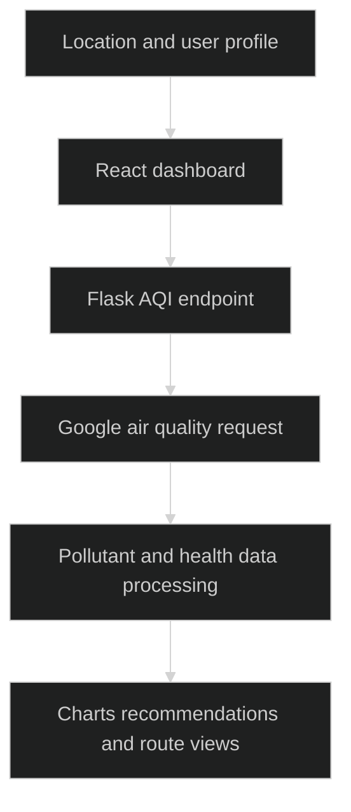

# CitizenApp

> `Air-quality dashboards backed by a Flask API and personalized browser views.`

### 🏗️ System Architecture



### 🛠️ Production Stack

React · Tailwind CSS · Firebase · Flask · Google Air Quality and Maps APIs · EmailJS

### ⚡ Key Engineering Capabilities

- Location-based requests connect environmental measurements to dashboard views.
- Flask centralizes air quality requests and response processing.
- Firebase profile state supports personalized health and notification settings.

### 🚀 Deployment and Local Setup

Run from the repository root after cloning:

```bash
git clone https://github.com/ryash14/CitizenApp.git
cd CitizenApp
npm install
npm start
# In a separate Python virtual environment:
# pip install flask flask-cors requests
# python backend/app.py
```

Set `REACT_APP_BACKEND_URL` to the Flask origin, defaulting to http://localhost:5000. Configure Firebase, Maps, air-quality and EmailJS integrations. Current source includes hard-coded service configuration; move private keys to environment variables and rotate exposed credentials before deployment. Forecast and route views should not be treated as validated environmental predictions.

### Verification

```bash
npm run build
```

These commands are provided by the source configuration; this documentation update does not claim a fresh end-to-end application run.

### Source Map

- [backend/app.py](backend/app.py)
- [src/utils/apiService.js](src/utils/apiService.js)
- [src/pages/Dashboard.jsx](src/pages/Dashboard.jsx)
