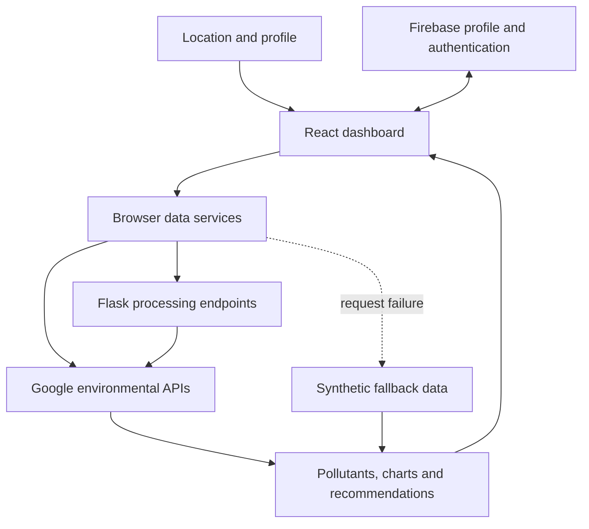

# CitizenApp

CitizenApp presents location-based air-quality views, pollutant breakdowns and profile-aware recommendations.

An air-quality number is more useful when it is connected to location, constituent pollutants and a person’s saved preferences. CitizenApp combines those views in a React interface, with a Flask service and browser integrations for environmental data.

[Quick start](#quick-start) · [Architecture](#architecture-and-request-flow) · [Development](#development) · [Contributing](CONTRIBUTING.md)

## Capabilities

| Workflow | Result |
|---|---|
| Locate conditions | Request air-quality information for the selected coordinates. |
| Understand pollutants | Inspect charts and contextual health information. |
| Check provenance | Distinguish live requests from synthetic fallback behavior. |

## Quick start

Configure Firebase, Google Air Quality/Maps and any EmailJS integration you use. The inspected source contains hard-coded provider configuration; move private credentials server-side and rotate exposed keys before public deployment.

From a fresh checkout:

```bash
git clone https://github.com/ryash14/CitizenApp.git
cd CitizenApp
npm install
npm start
# In a separate Python virtual environment:
# pip install flask flask-cors requests
# python backend/app.py
```

Set `REACT_APP_BACKEND_URL` to the Flask origin, defaulting to http://localhost:5000. Configure Firebase, Maps, air-quality and EmailJS integrations. Current source includes hard-coded service configuration; move private keys to environment variables and rotate exposed credentials before deployment. Forecast and route views should not be treated as validated environmental predictions.

## Architecture and request flow

1. Sign in, choose a location and complete profile preferences.
2. Request air-quality information through the application data services.
3. Inspect pollutant charts, contextual recommendations and related views.
4. Check the data source and request status before interpreting a displayed value as a live observation.

### Component model



### Engineering decisions

The application has both Flask-backed processing and browser-side provider requests. Some frontend request failures produce synthetic fallback data. Those values are demonstration behavior, not measured air-quality observations.

The frontend service defaults to a local backend origin, but not every fetch path uses that origin consistently. Provider credentials, request routing and fallback labeling need review before deployment. Profile data belongs behind appropriate Firebase access rules.

## Implementation

**Stack:** React · Tailwind CSS · Firebase · Flask · Google Air Quality and Maps APIs · EmailJS.

- [backend/app.py](backend/app.py)
- [src/utils/apiService.js](src/utils/apiService.js)
- [src/pages/Dashboard.jsx](src/pages/Dashboard.jsx)

## Development

Run the repository checks after completing setup:

```bash
npm run build
```

Use the offline checks during development. Run provider-backed integration checks separately with configured credentials and representative inputs.

## Contributing and support

Report reproducible bugs or propose changes through [GitHub Issues](https://github.com/ryash14/CitizenApp/issues). Include the relevant environment and a small example rather than private datasets or credentials. See [contributing](CONTRIBUTING.md), [security reporting](SECURITY.md) and the [code of conduct](CODE_OF_CONDUCT.md).

## License

No repository-wide license is currently provided. Third-party components, models and datasets retain their own terms.
